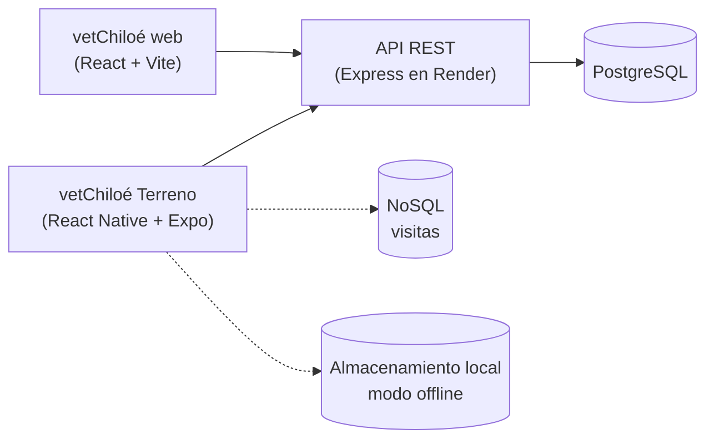

# Welcome to your Expo app 👋

This is an [Expo](https://expo.dev) project created with [`create-expo-app`](https://www.npmjs.com/package/create-expo-app).

## Get started

1. Install dependencies

   ```bash
   npm install
   ```

2. Start the app

   ```bash
   npx expo start
   ```

In the output, you'll find options to open the app in a

- [development build](https://docs.expo.dev/develop/development-builds/introduction/)
- [Android emulator](https://docs.expo.dev/workflow/android-studio-emulator/)
- [iOS simulator](https://docs.expo.dev/workflow/ios-simulator/)
- [Expo Go](https://expo.dev/go), a limited sandbox for trying out app development with Expo

You can start developing by editing the files inside the **src/app** directory. This project uses [file-based routing](https://docs.expo.dev/router/introduction).

## Get a fresh project

When you're ready, run:

```bash
npm run reset-project
```

This command will move the starter code to the **example** directory and create a blank **src/app** directory where you can start developing.

### Other setup steps

- To set up ESLint for linting, run `npx expo lint`, or follow our guide on ["Using ESLint and Prettier"](https://docs.expo.dev/guides/using-eslint/)
- If you'd like to set up unit testing, follow our guide on ["Unit Testing with Jest"](https://docs.expo.dev/develop/unit-testing/)
## Learn more

To learn more about developing your project with Expo, look at the following resources:

- [Expo documentation](https://docs.expo.dev/): Learn fundamentals, or go into advanced topics with our [guides](https://docs.expo.dev/guides).
- [Learn Expo tutorial](https://docs.expo.dev/tutorial/introduction/): Follow a step-by-step tutorial where you'll create a project that runs on Android, iOS, and the web.

## Join the community

Join our community of developers creating universal apps.

- [Expo on GitHub](https://github.com/expo/expo): View our open source platform and contribute.
- [Discord community](https://chat.expo.dev): Chat with Expo users and ask questions.

# App Móvil: vetChiloé en Terreno

**La clínica, ahora en terreno**

Prototipo móvil para el veterinario o veterinaria de **vetChiloé** que visita predios rurales de Chiloé. Actualmente muestra fichas de pacientes de ejemplo.

Este es el proyecto de la **Unidad II** de _Tecnología Web y Móvil_ de la carrera de Ingeniería Civil en Informática de la Universidad de Los Lagos, y continúa el sistema web **vetChiloé** de la Unidad I: **un mismo backend y dos clientes**, web y móvil.



---

## Tecnologías

|                        |                                                   |
| ---------------------- | ------------------------------------------------- |
| Framework              | [Expo](https://expo.dev) **SDK 58**               |
| Base                   | React Native 0.88 (Nueva Arquitectura) · React 19 |
| Lenguaje               | JavaScript                                        |
| Navegación             | Expo Router (rutas basadas en archivos)           |
| Pruebas en el teléfono | Expo Go (SDK 58)                                  |

## Requisitos

- **Node.js** 22.13+, 24.3+ o 26+ (solo versiones pares). Revisa con `node -v`.
- **Git** y una cuenta de **GitHub** con la invitación al repositorio aceptada.
- **Expo Go** en tu teléfono ([Android](https://play.google.com/store/apps/details?id=host.exp.exponent) · [iOS](https://apps.apple.com/app/expo-go/id982107779)).
- Computador y teléfono en la **misma red Wi-Fi**.

## Inicio rápido

```bash
git clone https://github.com/Vikktor93/vetchiloe-terreno.git
cd vetchiloe-terreno
npm install
git checkout -b estudiante/cristobal-onate
npx expo start
```

Escanea el código QR con **Expo Go** (Android) o con la **cámara** (iOS).

> ⚠️ Trabaja **siempre en tu rama** `estudiante/cristobal-onate`. La rama `main` está protegida y contiene solo la plantilla base.
> El flujo completo, con commits, entregas por Pull Request y la solución de problemas, está en **[guia-git/](guia-git/README.md)**.

## Comandos útiles

| Comando                      | Para qué                                                                                             |
| ---------------------------- | ---------------------------------------------------------------------------------------------------- |
| `npx expo start`             | Levanta el servidor de desarrollo                                                                    |
| `npx expo start -c`          | Igual, pero limpia la caché (después de cambiar de rama o de `reset-project`)                        |
| `npx expo start --tunnel`    | Si la red bloquea la conexión con el teléfono                                                        |
| `npm run lint`               | Revisa el código con ESLint                                                                          |
| `npx expo install <paquete>` | Instala una librería en la versión compatible con el SDK 58 (usar en vez de `npm install <paquete>`) |
| `npm run reset-project`      | Limpia la plantilla de ejemplo (Paso 1 de la guía, una sola vez y en tu rama)                        |

## Estructura

#### **Última Actualización: (11 de Noviembre)**

A continuación se muestra la estructura del proyecto después del Avance 01:

```
vetchiloe-terreno/
├── assets/                    imágenes e íconos
├── src/
│   ├── app/                   pantallas (cada archivo es una ruta)
│   │   ├── _layout.jsx        navegación y encabezado
│   │   └── index.jsx          pantalla de inicio
│   ├── components/            componentes reutilizables
│   │   └── TarjetaPaciente.jsx
│   └── data/
│       └── pacientesMocks.jsx pacientes de ejemplo
├── guia-git/                  flujo de trabajo con Git
├── app.json                   identidad de la app
├── package.json
└── tsconfig.json              configuración del proyecto (el atajo @/ apunta a src/)
```

## Hoja de ruta

Un módulo nuevo por tópico de la unidad:

| Tópico                                    | Módulo en la app                                 | Estado       |
| ----------------------------------------- | ------------------------------------------------ | ------------ |
| 01 - Arquitectura RN y Expo               | Proyecto base y pantalla de inicio con pacientes | 🟢 Avance 01 |
| 02 - Componentes, estilos y navegación    |                                                  | ⚪           |
| 03 - Ergonomía móvil y sistemas de diseño |                                                  | ⚪           |
| 04 - APIs REST y estado asíncrono         |                                                  | ⚪           |
| 05 - Persistencia NoSQL y BaaS            |                                                  | ⚪           |
| 06 - Almacenamiento local y offline       |                                                  | ⚪           |
| 07 - Hardware y sensores                  |                                                  | ⚪           |
| 08 - Seguridad y rendimiento              |                                                  | ⚪           |
| 09 - Compilación y EAS                    |                                                  | ⚪           |

## Historias de usuario

> 📝 **Avance 01:** cada estudiante reemplaza esta sección, **en su rama**, por sus 3 historias de usuario.

\**Formato: *Como veterinario/a en terreno, quiero … para …\*

1. Como veterinario/a en terreno, quiero …, para …
2. Como veterinario/a en terreno, quiero …, para …
3. Como veterinario/a en terreno, quiero …, para …

## Autor/a

- **Nombre:** Cristóbal Alexis Oñate
- **Rama:** `estudiante/cristobal-onate`

---

## Créditos

**Asignatura:** Tecnología Web y Móvil, Ingeniería Civil en Informática  
**Docente y Desarrollador Principal:** Victor Saldivia Vera - victor.saldivia@ulagos.cl
