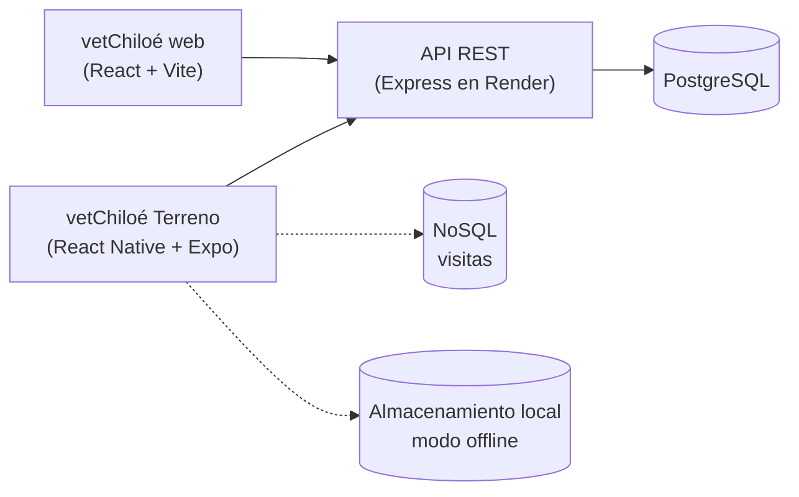

# App Móvil: vetChiloé en Terreno 

**La clínica, ahora en terreno**

App móvil para el veterinario o veterinaria de **vetChiloé** que visita predios rurales de Chiloé: consulta las fichas de los pacientes, registra visitas **sin señal**, toma fotos como evidencia y guarda la ubicación del predio.

Este es el proyecto de la **Unidad II** de *Tecnología Web y Móvil* de la carrera de Ingeniería Civil en Informática de la Universidad de Los Lagos, y continúa el sistema web **vetChiloé** de la Unidad I: **un mismo backend y dos clientes**, web y móvil.



---

## Tecnologías

| | |
|---|---|
| Framework | [Expo](https://expo.dev) **SDK 58** |
| Base | React Native 0.88 (Nueva Arquitectura) · React 19 |
| Lenguaje | TypeScript |
| Navegación | Expo Router (rutas basadas en archivos) |
| Pruebas en el teléfono | Expo Go (SDK 58) |

## Requisitos

- **Node.js** 22.13+, 24.3+ o 26+ (solo versiones pares). Revisa con `node -v`.
- **Git** y una cuenta de **GitHub** con la invitación al repositorio aceptada.
- **Expo Go** en tu teléfono ([Android](https://play.google.com/store/apps/details?id=host.exp.exponent) · [iOS](https://apps.apple.com/app/expo-go/id982107779)).
- Computador y teléfono en la **misma red Wi-Fi**.

## Inicio rápido

```bash
git clone https://github.com/Vikktor93/vetchiloe-terreno.git
cd vetchiloe-terreno
npm install
git checkout -b estudiante/nombre-apellido
npx expo start
```

Escanea el código QR con **Expo Go** (Android) o con la **cámara** (iOS).

> ⚠️ Trabaja **siempre en tu rama** `estudiante/nombre-apellido`. La rama `main` está protegida y contiene solo la plantilla base.
> El flujo completo, con commits, entregas por Pull Request y la solución de problemas, está en **[guia-git/](guia-git/README.md)**.

## Comandos útiles

| Comando | Para qué |
|---|---|
| `npx expo start` | Levanta el servidor de desarrollo |
| `npx expo start -c` | Igual, pero limpia la caché (después de cambiar de rama o de `reset-project`) |
| `npx expo start --tunnel` | Si la red bloquea la conexión con el teléfono |
| `npx tsc --noEmit` | Revisa los tipos de TypeScript sin generar archivos |
| `npx expo install <paquete>` | Instala una librería en la versión compatible con el SDK 58 (usar en vez de `npm install <paquete>`) |
| `npm run reset-project` | Limpia la plantilla de ejemplo (Paso 1 de la guía, una sola vez y en tu rama) |

## Estructura

#### **Última Actualización: (09 de Noviembre)**
A continuación se muestra la estructura del proyecto después del Avance 01:

```
vetchiloe-terreno/
├── assets/                    imágenes e íconos
├── src/
│   ├── app/                   pantallas (cada archivo es una ruta)
│   │   ├── _layout.tsx        navegación y encabezado
│   │   └── index.tsx          pantalla de inicio
│   ├── components/            componentes reutilizables
│   │   └── TarjetaPaciente.tsx
│   └── data/
│       └── pacientesMock.ts   pacientes de ejemplo
├── guia-git/                  flujo de trabajo con Git
├── app.json                   identidad de la app
├── package.json
└── tsconfig.json              TypeScript (el atajo @/ apunta a src/)
```

## Hoja de ruta

Un módulo nuevo por tópico de la unidad:

| Tópico | Módulo en la app | Estado |
|---|---|---|
| 01 - Arquitectura RN y Expo | Proyecto base y pantalla de inicio con pacientes | 🟢 Avance 01 |
| 02 - Componentes, estilos y navegación |  | ⚪ |
| 03 - Ergonomía móvil y sistemas de diseño |  | ⚪ |
| 04 - APIs REST y estado asíncrono |  | ⚪ |
| 05 - Persistencia NoSQL y BaaS |  | ⚪ |
| 06 - Almacenamiento local y offline |  | ⚪ |
| 07 - Hardware y sensores |  | ⚪ |
| 08 - Seguridad y rendimiento |  | ⚪ |
| 09 - Compilación y EAS |  | ⚪ |

## Historias de usuario

> 📝 **Avance 01:** cada estudiante reemplaza esta sección, **en su rama**, por sus 3 historias de usuario.

**Formato: *Como veterinario/a en terreno, quiero … para …*

1. Como veterinario/a en terreno, quiero …, para …
2. Como veterinario/a en terreno, quiero …, para …
3. Como veterinario/a en terreno, quiero …, para …

## Autor/a

> ✏️ Completa en tu rama:

- **Nombre:** …
- **Rama:** `estudiante/nombre-apellido`

---
## Créditos

**Asignatura:** Tecnología Web y Móvil, Ingeniería Civil en Informática  
**Docente y Desarrollador Principal:** Victor Saldivia Vera - victor.saldivia@ulagos.cl
