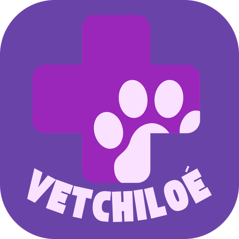
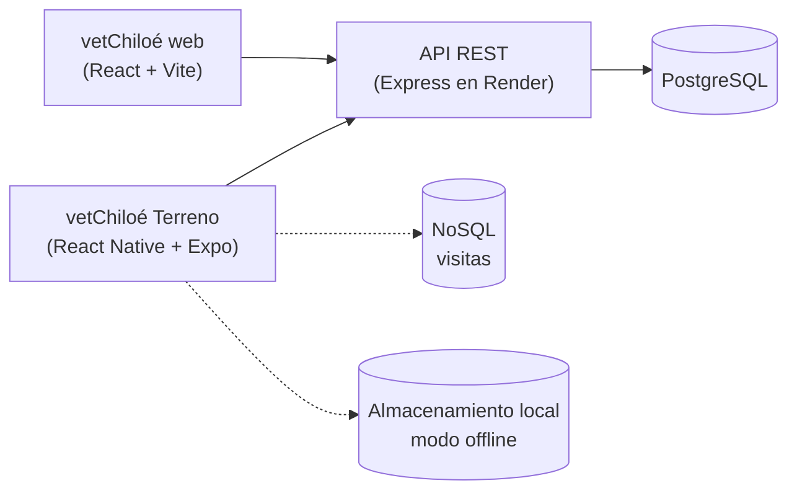

<p align="center">
  
</p>

# App Móvil: vetChiloé en Terreno

**La clínica, ahora en terreno**

App móvil para el veterinario o veterinaria de **vetChiloé** que visita predios rurales de Chiloé: consulta las fichas de los pacientes, registra visitas **sin señal**, toma fotos como evidencia y guarda la ubicación del predio.

Este es el proyecto de la **Unidad II** de *Tecnología Web y Móvil* de la carrera de Ingeniería Civil en Informática de la Universidad de Los Lagos, y continúa el sistema web **vetChiloé** de la Unidad I: **un mismo backend y dos clientes**, web y móvil.



---

## Tecnologías

| | |
|---|---|
| Framework | [Expo](https://expo.dev) **SDK 58** |
| Base | React Native 0.88 (Nueva Arquitectura) · React 19 |
| Lenguaje | TypeScript |
| Navegación | Expo Router: pestañas (`Tabs`) y pila de pantallas (`Stack`) |
| Íconos | `@expo/vector-icons` (Ionicons) |
| Sistema de diseño | Tokens en `src/constants/tema.ts` y componente `Boton` |
| Respuesta táctil | `expo-haptics` |
| Pruebas en el teléfono | Expo Go (SDK 58) |

## Requisitos

- **Node.js** 22.13+, 24.3+ o 26+ (solo versiones pares). Revisa con `node -v`.
- **Git** y una cuenta de **GitHub** con la invitación al repositorio aceptada.
- **Expo Go** en tu teléfono ([Android](https://play.google.com/store/apps/details?id=host.exp.exponent) - [iOS](https://apps.apple.com/app/expo-go/id982107779)).
- Computador y teléfono en la **misma red Wi-Fi**.

## Inicio rápido

```bash
git clone https://github.com/Vikktor93/vetChiloe-terreno.git
cd vetChiloe-terreno
npm install
git checkout -b estudiante/nombre-apellido
npx expo start
```

Escanea el código QR con **Expo Go** (Android) o con la **cámara** (iOS).

> ⚠️ Trabaja **siempre en tu rama** `estudiante/nombre-apellido`. La rama `main` está protegida y contiene solo la plantilla base.
> El flujo completo, con commits, entregas por Pull Request y la solución de problemas, está en **[guia-git/](guia-git/README.md)**.

## Comandos útiles

| Comando | Para qué |
|---|---|
| `npx expo start` | Levanta el servidor de desarrollo |
| `npx expo start -c` | Igual, pero limpia la caché (después de cambiar de rama o de `reset-project`) |
| `npx expo start --tunnel` | Si la red bloquea la conexión con el teléfono |
| `npx tsc --noEmit` | Revisa los tipos de TypeScript sin generar archivos |
| `npx expo install <paquete>` | Instala una librería en la versión compatible con el SDK 58 (usar en vez de `npm install <paquete>`) |
| `npm run reset-project` | Limpia la plantilla de ejemplo (Paso 1 de la guía, una sola vez y en tu rama) |

## Interfaces

<p align="center">
  
</p>

<p align="center"><sub>Estado actual (Avance 03). Grabado en la versión web con el tamaño de un teléfono.</sub></p>

## ¿Qué hace la App Móvil hoy?

| Pantalla | Ruta | Qué muestra |
|---|---|---|
| Splash | - | Huellas sobre fondo violeta que terminan en el logo de vetChiloé |
| Pacientes | `/` | Logo en el encabezado, lista de pacientes con buscador (ícono de lupa) y aviso "Sin resultados" |
| Ficha | `/paciente/[id]` | Foto, especie, edad, N° de atención y diagnóstico. Botón «Registrar visita» fijo abajo, en la zona del pulgar |
| Visita en Terreno | `/visitas` | Pantalla provisoria: "Próximamente" |
| Perfil | `/perfil` | Datos del veterinario o veterinaria |

> Los pacientes todavía vienen de `src/data/pacientesMock.ts`. En el Avance 04 se cargan desde la API.

## Estructura

#### **Última actualización: 27 de noviembre (Avance 03)**

```
└── 📁vetchiloe-terreno
    └── 📁.claude
    └── 📁.expo
        └── 📁types
            ├── router.d.ts
        ├── devices.json
        ├── README.md
    └── 📁.vscode
        ├── extensions.json
        ├── settings.json
    └── 📁assets
        └── 📁expo.icon
            └── 📁Assets
                ├── expo-symbol 2.svg
                ├── grid.png
            ├── icon.json
        └── 📁images
            ├── android-icon-background.png
            ├── android-icon-foreground.png
            ├── android-icon-monochrome.png
            ├── favicon.png
            ├── icon.png
            ├── logo-isotipo.png
            ├── logo.png
            ├── splash-icon.png
    └── 📁docs
        └── 📁img
            ├── demo.gif
            ├── logo-readme.png
    └── 📁example
        └── 📁assets
            └── 📁images
                └── 📁tabIcons
                    ├── explore.png
                    ├── explore@2x.png
                    ├── explore@3x.png
                    ├── home.png
                    ├── home@2x.png
                    ├── home@3x.png
                ├── expo-badge-white.png
                ├── expo-badge.png
                ├── expo-logo.png
                ├── logo-glow.png
                ├── react-logo.png
                ├── react-logo@2x.png
                ├── react-logo@3x.png
                ├── tutorial-web.png
        └── 📁scripts
            ├── reset-project.js
        └── 📁src
            └── 📁app
                ├── _layout.tsx
                ├── explore.tsx
                ├── index.tsx
            └── 📁components
                └── 📁ui
                    ├── collapsible.tsx
                ├── animated-icon.module.css
                ├── animated-icon.tsx
                ├── animated-icon.web.tsx
                ├── app-tabs.tsx
                ├── app-tabs.web.tsx
                ├── external-link.tsx
                ├── hint-row.tsx
                ├── themed-text.tsx
                ├── themed-view.tsx
                ├── web-badge.tsx
            └── 📁constants
                ├── theme.ts
            └── 📁hooks
                ├── use-color-scheme.ts
                ├── use-color-scheme.web.ts
                ├── use-theme.ts
            ├── global.css
    └── 📁guia-git
        ├── flujo-docente.md
        ├── flujo-estudiante.md
        ├── problemas-frecuentes.md
        ├── README.md
    └── 📁src
        └── 📁app
            └── 📁(tabs)
                ├── _layout.tsx
                ├── index.tsx
                ├── perfil.tsx
                ├── visitas.tsx
            └── 📁paciente
                ├── [id].tsx
            ├── _layout.tsx
        └── 📁components
            ├── Boton.tsx
            ├── SplashHuellas.tsx
            ├── TarjetaPaciente.tsx
        └── 📁constants
            ├── tema.ts
        └── 📁data
            ├── pacientesMock.ts
    ├── .gitignore
    ├── app.json
    ├── expo-env.d.ts
    ├── LICENSE
    ├── package-lock.json
    ├── package.json
    ├── README.md
    └── tsconfig.json
```

## Hoja de ruta

Un módulo nuevo por tópico de la unidad:

| Tópico | Módulo en la app | Estado |
|---|---|---|
| 01 - Arquitectura RN y Expo | Proyecto base y pantalla de inicio con pacientes | 🟢 `avance-01` |
| 02 - Componentes, estilos y navegación | Pestañas, buscador y ficha del paciente | 🟢 `avance-02` |
| 03 - Ergonomía móvil y sistemas de diseño | Tema centralizado, componente `Boton` y acción "Registrar visita" | 🟢 `avance-03` |
| 04 - APIs REST y estado asíncrono | Pacientes desde la API de Render, con estados de carga y error | 🟡 Siguiente |
| 05 - Persistencia NoSQL y BaaS | Registro e historial de visitas a predios (MongoDB o Firebase) | ⚪ |
| 06 - Almacenamiento local y offline | Guardar sin señal y sincronizar después | ⚪ |
| 07 - Hardware y sensores | Cámara para la foto y GPS del predio | ⚪ |
| 08 - Seguridad y rendimiento | Inicio de sesión y listas fluidas | ⚪ |
| 09 - Compilación y EAS | APK instalable | ⚪ |

> La solución de cada avance queda en la rama `docente/solucion` y en su etiqueta (`avance-01`, `avance-02`…), que se publica al cerrar el plazo.

## Historias de usuario

> 📝 **Avance 01:** cada estudiante reemplaza esta sección, **en su rama**, por sus 3 historias de usuario.

**Formato:** *Como veterinario/a en terreno, quiero … para …*

1. Como veterinario/a en terreno, quiero …, para …
2. Como veterinario/a en terreno, quiero …, para …
3. Como veterinario/a en terreno, quiero …, para …

## Autor/a

> ✏️ Completa en tu rama:

- **Nombre:** …
- **Rama:** `estudiante/nombre-apellido`

---
## Créditos

**Asignatura:** Tecnología Web y Móvil y Bases de Datos Avanzadas, Ingeniería Civil en Informática  
**Docente y Desarrollador Principal:** Victor Saldivia Vera - victor.saldivia@ulagos.cl
