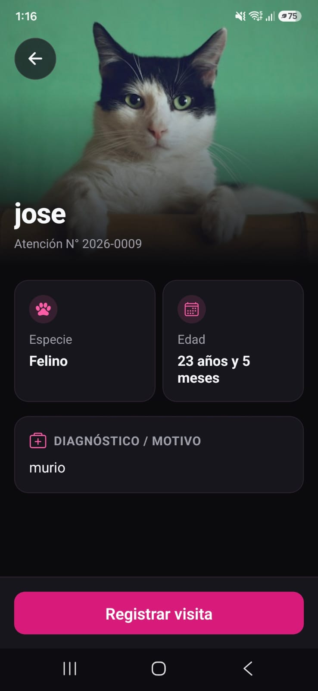
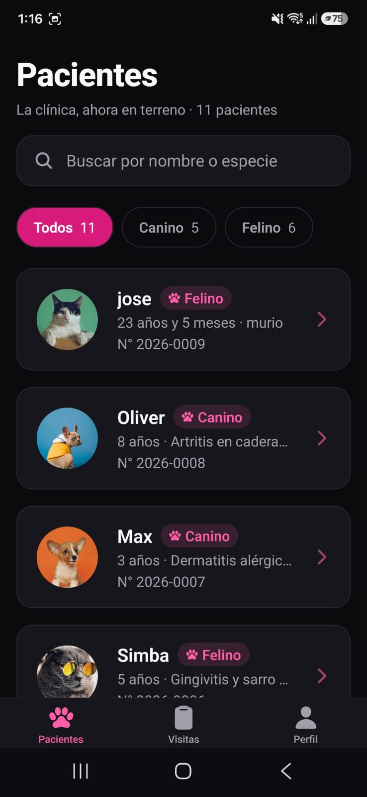
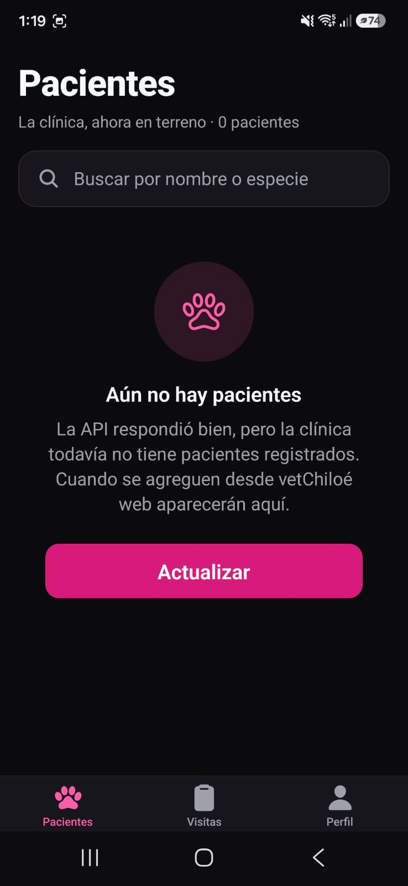
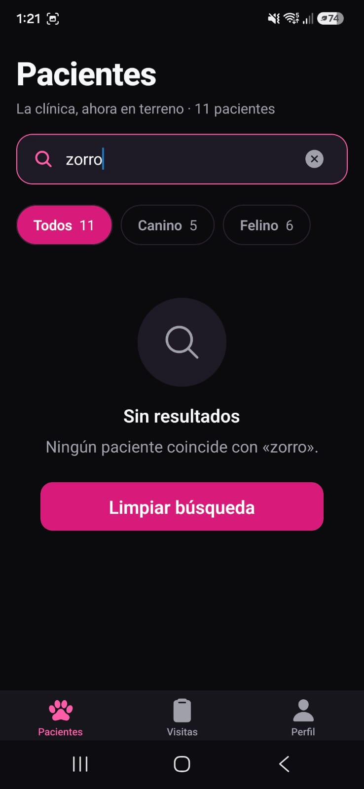

# Evidencia · Avances 03 y 04

**Estudiante:** Vicente Garin · rama `estudiante/Vicente-Garin`
Capturas tomadas en un teléfono Android con Expo Go (SDK 58).

---

## Avance 03 · Ergonomía y Sistema de Diseño

### Ficha con la acción principal en la zona del pulgar

### Checklist ergonómico

- [x] Las acciones principales están en la mitad inferior de la pantalla ("Registrar visita" fijo abajo).
- [x] Todo lo tocable mide al menos 48 dp (`minHeight` / `hitSlop`).
- [x] Ningún texto es menor a 14 y el cuerpo es de 16.
- [x] Los textos cumplen contraste 4,5:1 (rosa de texto `#FF5CA8` sobre fondo oscuro: 6,3:1).
- [x] Cada botón cambia al presionarlo (se encoge, cambia de color y vibra).
- [x] Tarjetas y botones tienen `accessibilityLabel` y `accessibilityRole`.
- [x] Ningún color ni tamaño suelto: todo sale de [`src/constants/tema.ts`](../../src/constants/tema.ts).

**Reto opcional:** vibración al tocar "Registrar visita" (`expo-haptics` en iOS, `Vibration` en Android).

---

## Avance 04 · Datos reales desde la API

La app consume la misma API de vetChiloé web: `https://vetchiloe.onrender.com`.

| Lista con pacientes reales | API sin pacientes | Búsqueda sin resultados (reto opcional) |
|:---:|:---:|:---:|
|  |  |  |

### Estado de error con Reintentar

_Captura pendiente._
<!-- Cuando la tengas: guárdala en esta carpeta como avance04-error-servidor.jpg
     y reemplaza "_Captura pendiente._" por:
      -->

### Checklist de la conexión con la API

- [x] La lista muestra los pacientes de la API, los mismos que vetChiloé web.
- [x] Al abrir la app aparece el indicador de carga (esqueleto) mientras Render despierta.
- [x] Con una URL incorrecta aparece el error y Reintentar funciona.
- [x] Deslizar hacia abajo recarga la lista.
- [x] La ficha carga el paciente por su id (`GET /api/pacientes/:id`).
- [x] Ninguna pantalla usa ya `pacientesMock` para los datos.

**Nota:** la API todavía no tiene la ruta `GET /api/pacientes/:id` (responde 404). Por eso `obtenerPaciente` en [`src/services/api.ts`](../../src/services/api.ts) tiene un respaldo que busca el paciente en la lista completa. Cuando se agregue la ruta al backend, la app la usará sin cambios.

**Estados de error y vacío:** las capturas de "API sin pacientes" y "error de servidor" se tomaron con el modo demostración (`EXPO_PUBLIC_SIMULAR` en `.env`), porque la API real está funcionando.

---

## Extras

- Animaciones con Reanimated: presión con resorte, entradas escalonadas, esqueletos de carga, encabezado que colapsa con el scroll, filtros por especie con píldora deslizante y foto con parallax en la ficha.
- Vibración al tocar tarjetas, pestañas y botones.
- Mensajes claros para cada falla: sin conexión, tiempo agotado, error de servidor (5xx), no encontrado (404) y lista vacía.
