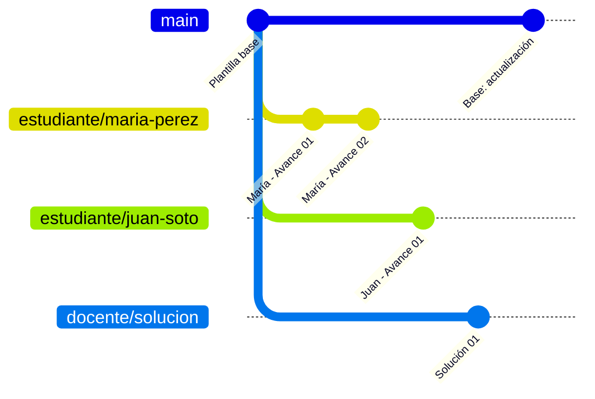
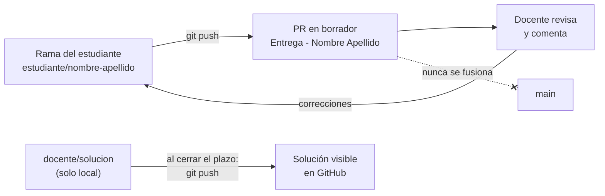

# Guía Git - vetChiloé en Terreno

**Asignatura:** Tecnología Web y Móvil - Unidad II  
**Docente:** Victor Saldivia Vera - victor.saldivia@ulagos.cl

Esta carpeta explica cómo trabajamos con Git y GitHub en el proyecto móvil **vetChiloé en Terreno**.

| Archivo | Para quién | Qué contiene |
|---|---|---|
| [flujo-estudiante.md](flujo-estudiante.md) | Estudiantes | Clonar, crear la rama, guardar avances, entregar con Pull Request y actualizarse |
| [flujo-docente.md](flujo-docente.md) | Docente | Configurar el repositorio, preparar la solución, revisar entregas y publicar la solución |
| [problemas-frecuentes.md](problemas-frecuentes.md) | Todos | Errores comunes y cómo resolverlos |

---

## La idea en una imagen

**Las ramas del repositorio:** todas nacen de `main`, y cada una avanza por separado.

**Cómo se entrega y se revisa:**

- **`main`** tiene la plantilla base del proyecto (Expo SDK 58). Está protegida: nadie puede modificarla salvo el docente.
- Cada estudiante trabaja **solo en su rama** `estudiante/nombre-apellido`.
- La entrega es un **Pull Request en borrador** de la rama del estudiante hacia `main`. **Nunca se fusiona**: es el lugar donde el docente revisa y comenta.
- El docente desarrolla la solución en `docente/solucion`, **solo en su computador**, y la sube a GitHub cuando cierra el plazo de cada avance.

## Convenciones

| Elemento | Formato | Ejemplo |
|---|---|---|
| Rama del estudiante | `estudiante/nombre-apellido` (minúsculas, sin tildes ni ñ) | `estudiante/maria-perez` |
| Mensaje de commit de avance | `Avance NN: descripción breve` | `Avance 01: pantalla de inicio` |
| Commits intermedios | Verbo + qué cambió | `Agrega TarjetaPaciente con foto` |
| Título del Pull Request | `Entrega - Nombre Apellido` | `Entrega - María Pérez` |
| Rama del docente | `docente/solucion` | - |
| Commits del docente en `main` | `Base: descripción` | `Base: imágenes de pacientes` |

## Lo que NO se sube al repositorio

Ya está configurado en `.gitignore`:

- `node_modules/`: se reconstruye con `npm install`.
- `.expo/`: caché local de Expo.
- `example/`: la plantilla original que guarda `npm run reset-project`. Queda en tu computador para consultarla.
- `AGENTS.md` y `.claude/`: archivos de configuración de asistentes de IA Gen.

## Glosario rápido

| Término | Significado |
|---|---|
| **Repositorio** | La carpeta del proyecto con todo su historial de cambios. |
| **Clonar** | Descargar el repositorio de GitHub a tu computador (`git clone`). |
| **Rama** | Una línea de trabajo independiente. Lo que haces en tu rama no afecta a las demás. |
| **Commit** | Una "foto" guardada de tus cambios, con un mensaje que la describe. |
| **Push** | Subir tus commits a GitHub. |
| **Fetch / Pull** | Traer los cambios de GitHub a tu computador. `pull` además los aplica a tu rama actual. |
| **Merge** | Unir los cambios de una rama en otra. |
| **Pull Request (PR)** | Solicitud en GitHub para revisar los cambios de una rama. Aquí la usamos como **entrega**. |
| **Borrador (Draft)** | PR marcado como "en progreso", que no se puede fusionar por accidente. |
